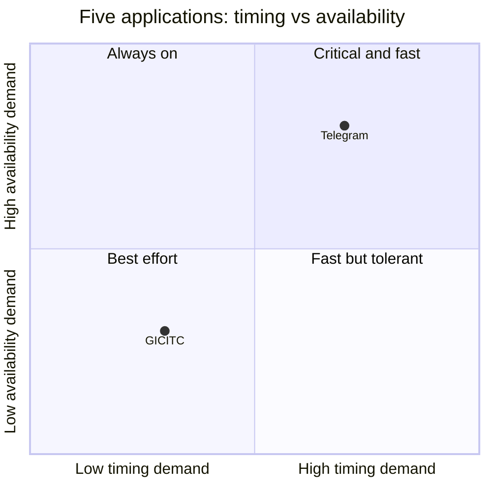

# Lab-02 · Classification of five applications

Version 1.0 · 2026-__-__ · Team: __

| # | Application             | Kind                 | Type(s) | Where the code runs, how it is delivered | Architecture | Top 3 qualities (why) | Filled by |
| - | ----------------------- | -------------------- | ------- | ---------------------------------------- | ------------ | --------------------- | --------- |
| 1 | Mobile banking app: FTB | Application software | PWA     | mobile,..                                |              |                       |           |
| 2 | Telegram                | Application software |         |                                          |              |                       |           |
| 3 | ABS controller in a car |                      |         |                                          |              |                       |           |
| 4 | Moodle at ITC           |                      |         |                                          |              |                       |           |
| 5 | Game: __                |                      |         |                                          |              |                       |           |

Biggest difference we found: __

