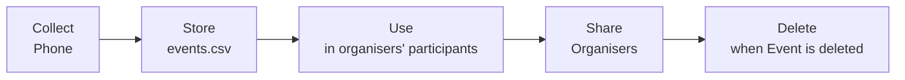

# Data inventory · ITC Club Hub

Version 0.1 · 2026-MM-DD · Authors: <names></names>

| Field       | Subject | Purpose                              | Legal basis / consent                                     | Retention               | Who can see it | Stored in              | Decision                                |
| ----------- | ------- | ------------------------------------ | --------------------------------------------------------- | ----------------------- | -------------- | ---------------------- | --------------------------------------- |
| studentId   | student | identify; block double registration  | necessary for the service                                 | Until account deleted   | Admin          | data/students.csv      | Mask for organisers: security reason    |
| name        | student | show in list of participants        | necessary for the service                                 | Until event is deleted | Orgainisers    | data/events.csv        | Mask for non-participants and outsiders |
| phone       | student | Show in list of participants         | consent (opt-in)                                          | Until event is deleted  | Organisers     | data/events.csv        | Mask for non-orgainiser                 |
| attendance  | student | Prepare for the present participants | legitimate interest: Reason: see how popular of the event | Until event ended       | Organisers     | data/registrations.csv | Mask for students                       |
| dateOfBirth | student | N/A                                  | Check duplicate participant                               | Until account deleted   | TODO           | TODO                   | TODO                                    |

## Copies of personal data

| Copy                | Rule                                                   |
| ------------------- | ------------------------------------------------------ |
| log files           | only `redacted()` output, never name, email or phone |
| CSV exports         | no DOB                                                 |
| test fixtures       | no photo                                               |
| backups             | N/A                                                    |
| screenshots in docs | Blur out the DOB, name, id, email, phone, telegram     |

## Lifecycle of the phone field

## Client feedback

- TODO
